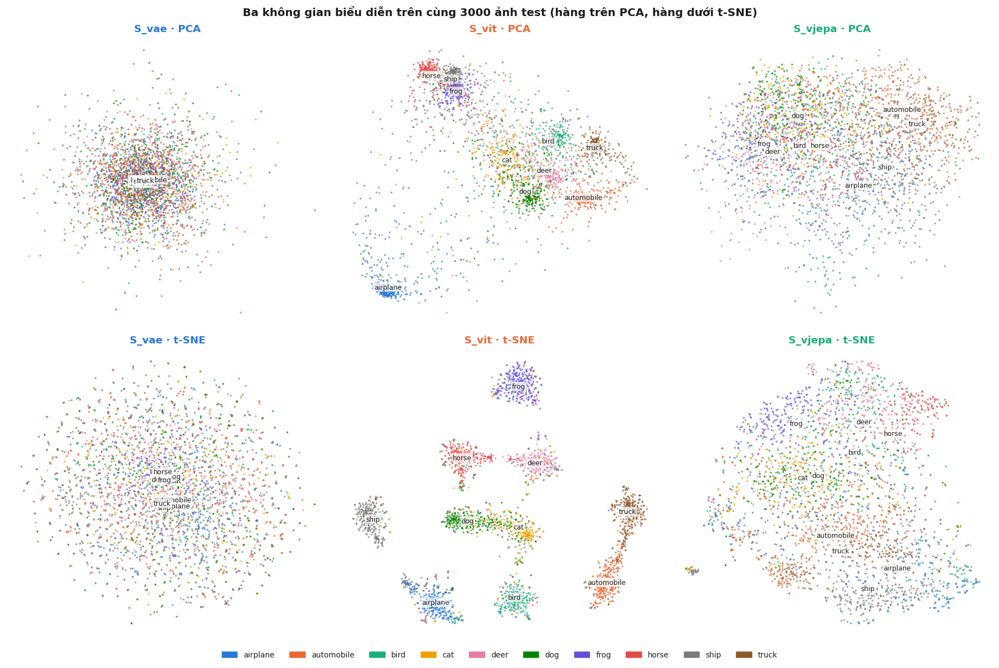
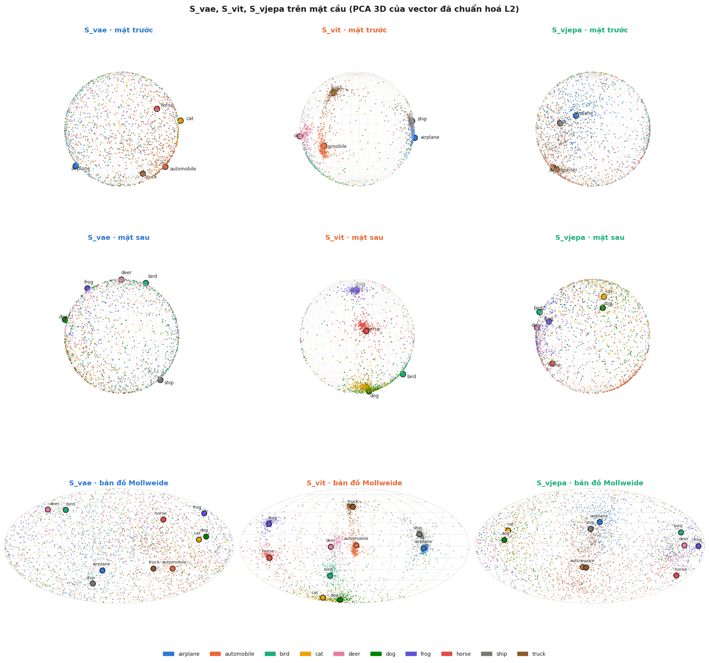
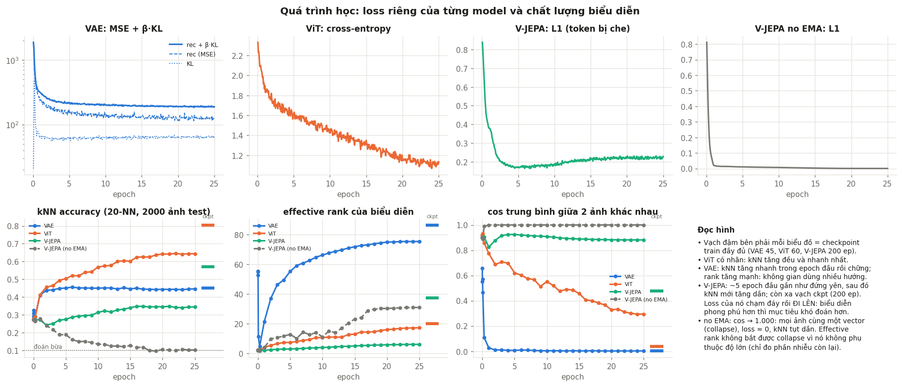

# VAE vs ViT vs V-JEPA: ba cách học biểu diễn ảnh khác nhau

**Học viên thực hiện:** Huỳnh Trung Bửu, MSHV 2590903

So sánh trực quan **cách học** của ba mô hình trên CIFAR-10. Cả ba dùng cùng dữ liệu và cùng tiền xử lý:

| | VAE | ViT (có giám sát) | V-JEPA |
|---|---|---|---|
| Thấy gì khi học | toàn bộ ảnh | toàn bộ ảnh | chỉ phần không bị che |
| Phải dự đoán gì | pixel của chính ảnh | nhãn lớp | **biểu diễn** của phần bị che |
| Dùng nhãn? | không | có | không |
| Không gian biểu diễn | `mu(x)`, 128 chiều | token `[CLS]`, 192 chiều | trung bình patch token của target encoder, 192 chiều |

Toàn bộ phân tích nằm trong notebook [`Learning_VAE_ViT_VJEPA.ipynb`](Learning_VAE_ViT_VJEPA.ipynb), kèm nhận xét dưới mỗi biểu đồ:

- ba không gian nhìn trực tiếp: PCA, t-SNE, trên mặt cầu, láng giềng gần nhất
- mỗi không gian có biết vật nằm ở đâu không, có "đọc" được từng góc ảnh không
- tín hiệu học và gradient theo pixel của từng mô hình
- train lại cả ba từ đầu song song (25 epoch): loss, kNN, rank, gradient từng tầng
- thí nghiệm collapse: V-JEPA khi bỏ EMA / stop-gradient
- attention, patch token, probe từng tầng, CKA
- độ bất biến, nội suy, hình học không gian, ma trận nhầm lẫn

<p align="center">
  <br>
  <br>
  
</p>

Mọi hình của lần chạy gần nhất nằm trong [`outputs_learning/`](outputs_learning/).

## Kết quả chính

| | S_vae | S_vit | S_vjepa |
|---|---|---|---|
| kNN accuracy (20-NN) | 0,51 | 0,81 | 0,59 |
| Linear probe | 0,43 | 0,80 | 0,65 |
| Bất biến hình học (lật, dịch, xoay, zoom) | 0,43 | 0,91 | 0,95 |

- **VAE** giữ nhiều thông tin nhất, nhưng đó là màu và bố cục, nên kém nhất về ngữ nghĩa và nhạy với việc dịch hay lật ảnh.
- **ViT** tách 10 lớp thành 10 cụm rõ nhờ nhãn, nhưng không gian chỉ dùng khoảng 9 hướng chính.
- **V-JEPA** không dùng nhãn mà vẫn tự gom ảnh theo nhóm lớn (động vật và xe cộ), và bất biến hình học tốt nhất. Đổi lại nó học rất chậm, và **loss của nó tăng đúng lúc biểu diễn tốt lên**.

## Chạy notebook

```bash
pip install -r requirements.txt
jupyter notebook Learning_VAE_ViT_VJEPA.ipynb
```

- CIFAR-10 được tải tự động vào `./data` ở lần chạy đầu.
- Checkpoint đã train sẵn nằm trong `checkpoints/`: VAE 45 epoch, ViT 60 epoch, V-JEPA 200 epoch.

## Tự train lại checkpoint

```bash
python train_vae.py   --epochs 45
python train_vit.py   --epochs 60
python train_vjepa.py --epochs 200
```

## Cấu trúc

| File | Nội dung |
|---|---|
| `Learning_VAE_ViT_VJEPA.ipynb` | notebook phân tích chính |
| `common.py` | dữ liệu, các khối ViT, lịch learning rate, đánh giá kNN |
| `train_vae.py`, `train_vit.py`, `train_vjepa.py` | định nghĩa mô hình và script huấn luyện |
| `checkpoints/` | trọng số đã train |
| `outputs_learning/` | hình do notebook tạo ra |
